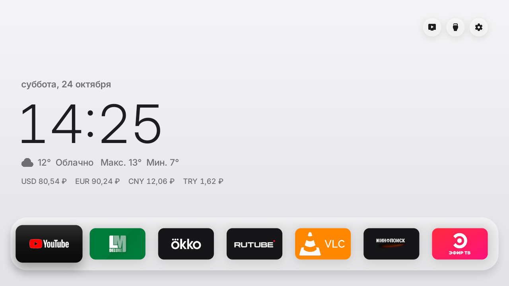
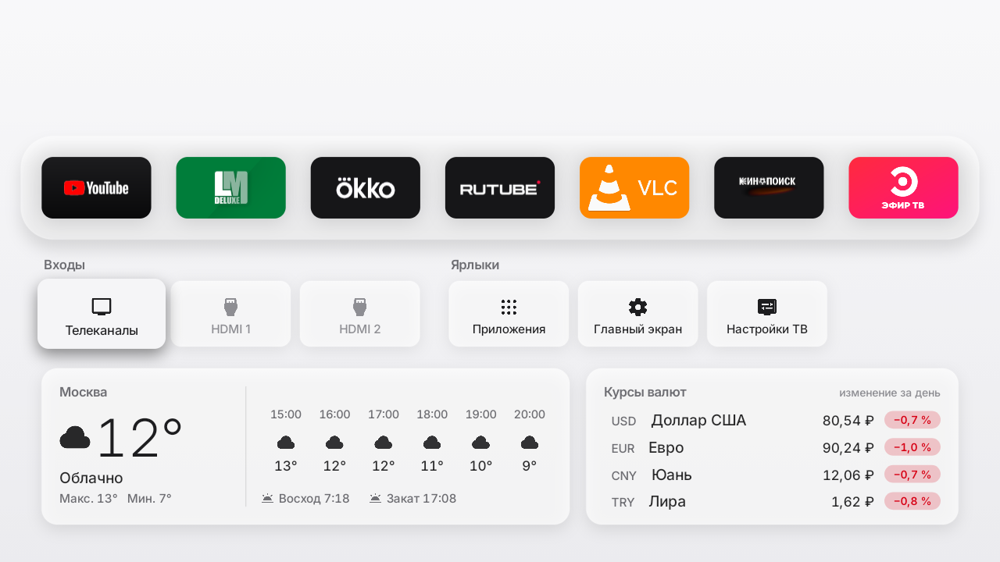
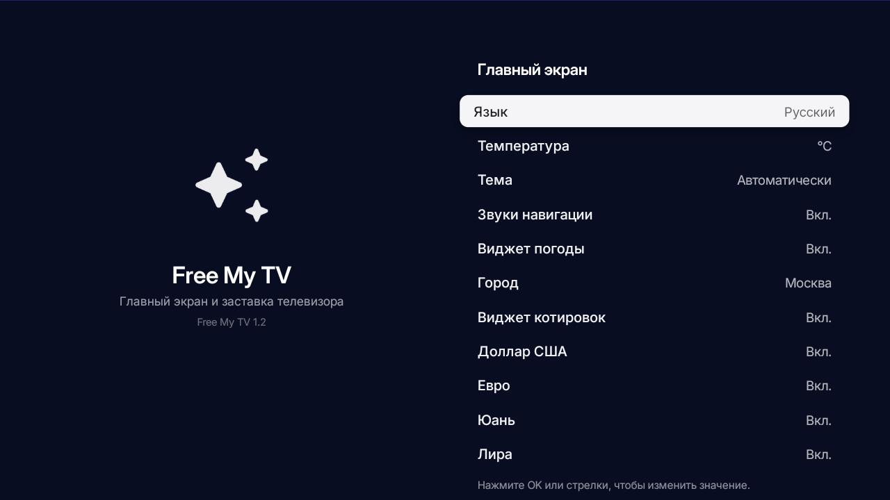
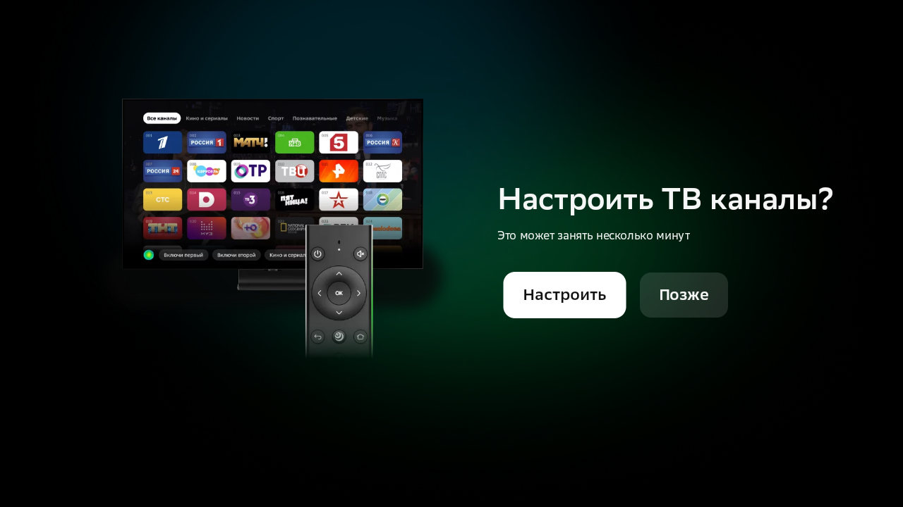
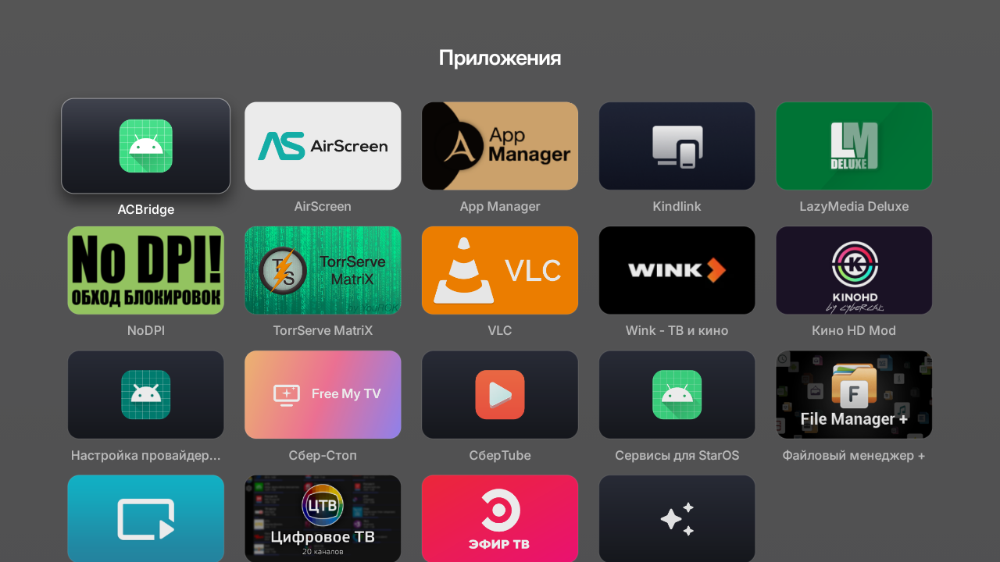
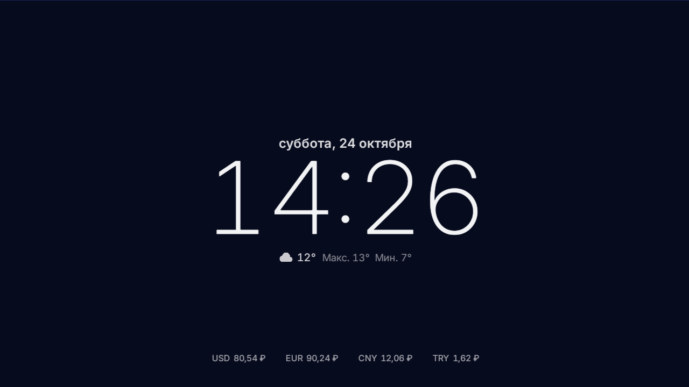
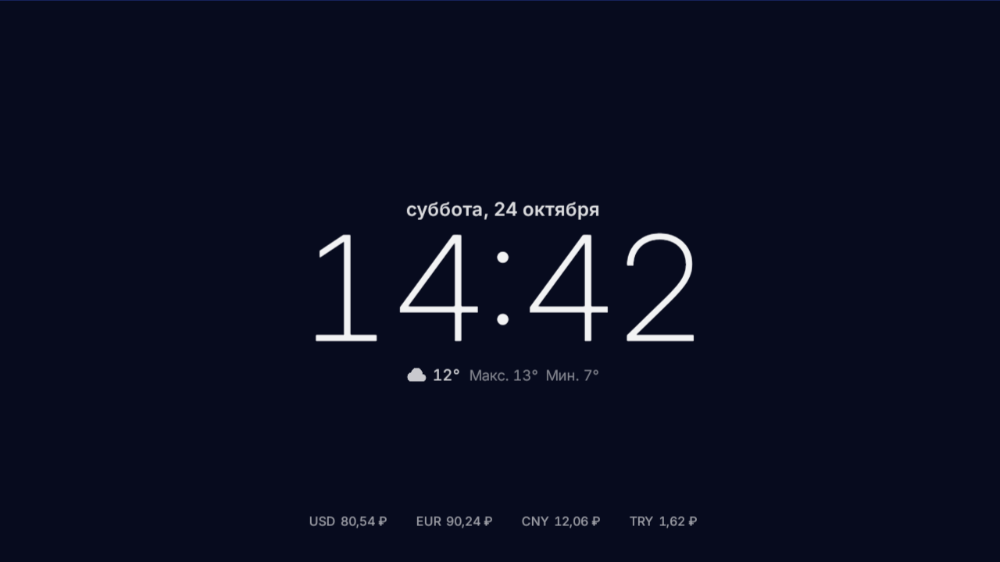

# Free My TV для телевизоров Сбера (Salute TV) + «Сбер-Стоп»

Сборка [Free My TV](https://github.com/simbasjungles/free-my-tv) с исправлениями под телевизоры **Salute TV (Сбер)**
и отдельное приложение **«Сбер-Стоп»**, которое не даёт телевизору вернуть отключённые приложения Сбера.

## Скриншоты

| Главный экран | Курсы валют (выдвижная панель) |
|---|---|
|  |  |

| Настройки — валюты | «Телеканалы» → родное Сбер-ТВ |
|---|---|
|  |  |

| Все приложения (там же «СберTube») | Заставка |
|---|---|
|  |  |

| СберTube |
|---|
|  |

## Проверено на

| | |
|---|---|
| Устройство | Сбер «Салют ТВ» — модель **SaluteTV** (`ro.product.model=SaluteTV`, `ro.product.name=SaluteTV`) |
| Плата / чип | MediaTek **MT5867**, `ro.board.platform=mt5867`, `ro.product.board=mt5867_eu` (шасси CVTE) |
| Процессор | 32-бит ARM (`armeabi-v7a`), экран 1280×720, плотность 213 dpi |
| Система | Android 11 (SDK 30), сборка `RP1A.200720.011`, `ro.build.tags=dev-keys` |
| Пульт | родной Bluetooth-пульт Сбера (`4B10`) + приложение-пульт с телефона |

## Что внутри

| Папка | Что это |
|---|---|
| `freemytv-sber/` | Исходники Free My TV с изменениями под Сбер; собирается без Gradle |
| `sberstop/` | «Сбер-Стоп»: небольшое Android-приложение (исходники + скрипт сборки) |
| `docs/УСТАНОВКА.ru.md` | Подробная инструкция: что сделано, что отключено, как вернуть/собрать/обновить |

## Чем отличается `freemytv-sber` от апстрима

1. **Кнопка «Телеканалы» работает.** На Salute TV стандартный запрос каналов попадает в настройки Android TV,
   которые сразу закрываются. Теперь открывается родное приложение Сбера **StarLiveTv**
   (`ru.sberdevices.starlivetv/.main.activity.MainActivity`).
   Правки: `app/src/io/freemytv/HomeApps.java` (`liveTv()`), `app/AndroidManifest.xml` (`<queries>`).

2. **Курсы валют вместо криптовалют.** Доллар США, евро, китайский юань и турецкая лира **к рублю** — официальные
   курсы ЦБ РФ (JSON-зеркало `cbr-xml-daily.ru`, обновление раз в сутки, кэш 30 минут). Показываются в строке на
   главном экране, в карточке «Курсы валют» (с изменением за день) и на заставке; в настройках — переключатель
   виджета и по одному переключателю на валюту.
   Правки: `HomeData.java`, `HomeView.java`, `DreamView.java`, `SettingsActivity.java`, `app/assets/i18n/ru.json`.

3. **Сборка под Windows без Gradle** — `build-windows.ps1` (`aapt2 → javac → d8 → zipalign → apksigner`).
   Нужны JDK 17 и Android SDK: `build-tools;34.0.0` + `platforms;android-34`.

4. **Поддержка «приватного» ярлыка Сбера** — `ru.sberdevices.category.STAR_LAUNCHER`: без этого СберTube не виден
   в списке приложений на Android 11 (видимость пакетов).

5. **Надёжное обновление курсов валют и новый ночной фон.** Добавлены резервные пулы зеркал (ЦБ РФ + fallback OpenExchangeRates), быстрый повтор при поднятии Wi-Fi после старта ТВ, и глубокий сапфирово-полночный фон с 3-точечным градиентом и дизерингом Байера против бандинга на 8-битных матрицах.

6. **Полноценный Root-доступ (`su`).** Реализован системный `su` в `/system/bin/su` и `/system/xbin/su` через сервисный шлюз `at_sudo` платы CVTE/MT5867. Доступен для любых скриптов и команд через `su` и `su -c "..."`.

7. **Установка приложений на USB-флешку (расширение памяти).** Флешка форматируется в нативный ext4 и бесшовно монтируется в `/data/app` через сервис автозапуска `init.usb_apps.rc`, расширяя базовые 2.7 ГБ ТВ до 64 ГБ.

8. **Резервная копия системы (`backup/`).** Сняты дампы всех пакетов, системных свойств, карты монтирования и hosts-файла с блокировкой серверов принудительных обновлений Сбера.

## Как собрать Free My TV

```powershell
# 1) JDK 17 + Android SDK (build-tools 34, platform android-34), пути поправьте под себя
$env:JAVA_HOME   = "C:\tools\jdk-17"
$env:ANDROID_HOME = "C:\tools\android-sdk"

# 2) по желанию: свой ключ подписи (в репозитории его нет и быть не должно)
& "$env:JAVA_HOME\bin\keytool.exe" -genkeypair -keystore freemytv.keystore -alias freemytv `
    -keyalg RSA -keysize 2048 -validity 20000 -storepass freemytv -keypass freemytv -dname "CN=Free My TV"

# 3) сборка
powershell -ExecutionPolicy Bypass -File .\build-windows.ps1

# 4) установка
adb connect 192.168.1.50:5555
adb install -r FreeMyTV.apk
```

`config.properties` (город, координаты, язык, регион) — рядом; ключ TMDB нужен только для рекомендаций.

## Как собрать «Сбер-Стоп»

```powershell
powershell -ExecutionPolicy Bypass -File .\sberstop\build-sberstop.ps1
adb install -r .\sberstop\SberStop.apk
```

Приложение работает через локальный ADB (`127.0.0.1:5555`) телевизора: после загрузки и каждые 15 минут отключает
(`pm disable-user`) список приложений Сбера, которые телевизор сам возвращает. Ничего не удаляется — всё обратимо
командой `pm enable`.

## Важно

- В репозитории **нет ключей подписи** и личных данных — соберите свой ключ.
- APK, собранные разными ключами, не встают друг на друга: обновляйте приложение только своей сборкой.
- Всё делается на вашем телевизоре и на ваш риск; инструкция описывает, как вернуть всё назад.

## Лицензия

MIT — см. [`freemytv-sber/LICENSE`](freemytv-sber/LICENSE). Free My TV © Free My TV contributors.
Изменения под Сбер и «Сбер-Стоп» — под той же лицензией.

## Благодарности

- [simbasjungles/free-my-tv](https://github.com/simbasjungles/free-my-tv) — главный экран и заставка.
- [raspabamos/nodpi](https://github.com/raspabamos/nodpi) — обход замедления YouTube (в эту сборку не входит).
